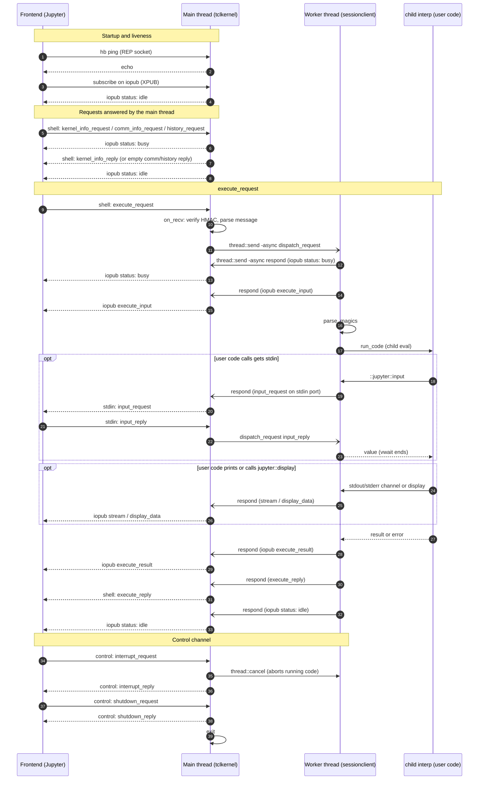

## Installation

### Local

With Tcl and Jupyter installed, install the kernel spec from the checkout directory:

- Unix: `make install`
- Windows: `make -f Makefile.win install`

The installer adds `kernel.json` and the logo to Jupyter's kernels directory. It does not install Tcl or its packages. On Windows, the install script defaults to `tclsh` on `PATH`; pass `-Tclsh <path>` to `scripts/install.ps1` to select another interpreter. The Unix Makefile uses `uv` to locate Jupyter's data directory.

Jupyter uses `kernel.json` to start the kernel and passes the connection file as the first argument.

### Docker

The `docker` folder contains a `Dockerfile` for building a tcljupyter container based on Alpine. An example `docker-compose.yml` file is provided.

Prebuilt images for amd64 and arm64 are on [Docker Hub](https://hub.docker.com/r/mpcjanssen/tcljupyter).

### Dependencies

The Tcl interpreter used to run `init.tcl` must be Tcl 8.6 or newer and provide:

- The Tcl Thread extension (`Thread`).
- The Tcl SQLite binding (`sqlite3`), with SQLite JSON functions enabled.
- Tcllib's `uuid` and `sha256` packages.

The ZeroMQ-compatible transport implementation is included in `lib/zmq`; the external `tclzmq` package and `libzmq` are not required. A Jupyter installation is also needed to launch the kernel.

Python and `uv` are only needed for the test suite (and `uv` is used by the Unix `make install` target to locate Jupyter).
## Supported

Most web client commands are supported. Only thing missing is reading from stdin with for example `gets`. 

### Commands

   * `jupyter::display mimetype body`: Display body in the cell. Returns the display id for use in `updatedisplay`.
   * `jupyter::html body`: Display body as html in the cell. Returns the display id for use in `updatedisplay`. 
   * `jupyter::updatedisplay id mimetype body`: Updates the display with id `id` with then new body.
   * `jupyter::updatehtml id body`: Updates the html display with id `id` with the new body.

### Magic commands

Magics are lines starting with `%%` at the top of the cell.

   * `##timeit ?count?`: Time the execution of the cell and display the results. Changing count will execute the cell multiple times and show the average time.
   * `##noresult`: Do not show the last result. This is convenient if the last result is very large. The same effect can be achieved by appending `;` to the last command of the cell.

## Test suite

The test suite requires Python 3.14 or newer and `uv`. Run these commands from the checkout directory:

- Unix: `make test`
- Windows: `make -f Makefile.win test`

The test command creates a temporary Jupyter kernelspec; you do not need to install the kernel first. Tcl and its runtime packages listed above must still be available.

## Design

The main thread (`lib/tclkernel`) owns the ZMQ sockets and routing. User code runs in a worker thread (`lib/sessionclient`) inside a `child` interpreter, so a running cell can be interrupted with `thread::cancel`. The two threads communicate with `thread::send -async`, and the worker's `stdout` and `stderr` are intercepted with `chan push` and sent to the notebook as `stream` messages.

